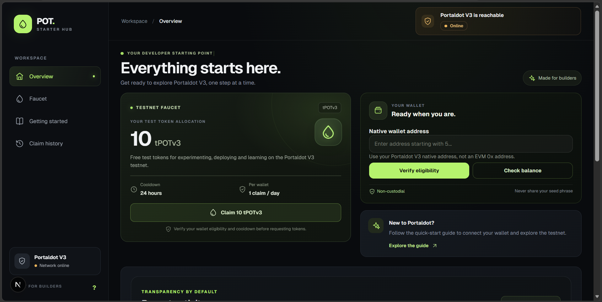
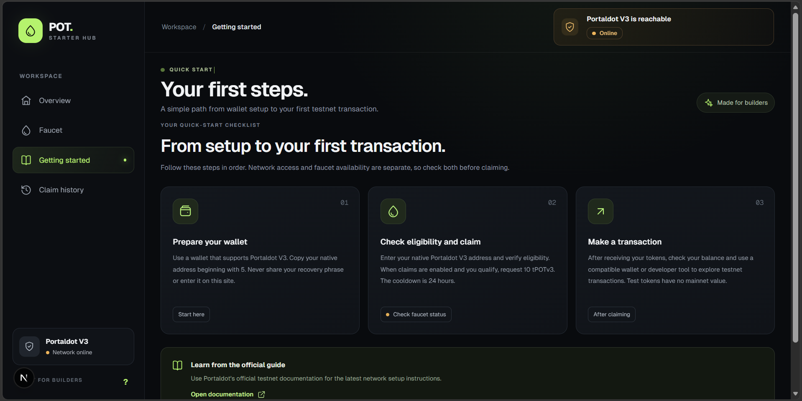
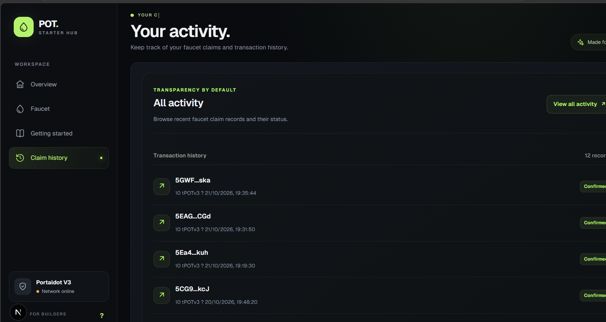
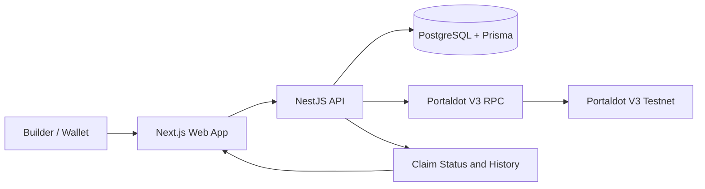


<div align="center">

# POT Starter Hub

### Your starting point for building on Portaldot V3

A self-service testnet faucet and developer quick-start hub for receiving **10 tPOTv3**, checking wallet eligibility, and exploring the Portaldot V3 ecosystem.

[Live Demo](https://pot-starter-hub.vercel.app) |
[GitHub Repository](https://github.com/neduojile/pot-starter-hub) |
[Portaldot Node Console](https://node-console.portaldot.dev)

</div>

---

## Overview

POT Starter Hub is a developer onboarding platform built to simplify access to the Portaldot V3 testnet.

It provides a straightforward interface where developers and ecosystem participants can check wallet eligibility, request test tokens, inspect balances, and follow their faucet claim history.

The goal is to reduce the friction between discovering the Portaldot ecosystem and completing a first testnet interaction.

| Network detail | Value |
|---|---|
| Network | Portaldot V3 Testnet |
| Test token | tPOTv3 |
| Faucet allocation | 10 tPOTv3 per confirmed claim |
| Cooldown | 24 hours per wallet |
| Native wallet format | Address beginning with `5` |
| EVM Chain ID | `420420777` |

## Screenshots

These screenshots showcase the main areas of the application.

### Overview



### Getting Started



### Claim History



> Ensure the screenshot files exist at the paths above before submitting the repository.

## Core Features

- **Testnet Faucet:** Request 10 tPOTv3 when claims are enabled and the wallet is eligible.
- **Native Wallet Eligibility:** Validate a Portaldot native wallet address before requesting tokens.
- **Balance Checker:** Inspect the available testnet balance of a connected or entered wallet.
- **Claim History:** Review recent faucet activity and reported transaction statuses.
- **Cooldown Enforcement:** Apply a 24-hour cooldown after a confirmed claim.
- **Developer Quick Start:** Follow a guided path from wallet preparation to the first testnet interaction.
- **Claim Tracking:** Monitor claim status and available transaction references.
- **Responsive Interface:** Access the platform across desktop and mobile devices.

## Portaldot V3 Network Details

| Setting | Value |
|---|---|
| Network | Portaldot V3 Testnet |
| Substrate WebSocket RPC | `wss://test-node-v3.portaldot.dev` |
| EVM RPC | `https://test-evm-rpc-v3.portaldot.dev` |
| EVM Chain ID | `420420777` |
| Token | `tPOTv3` |
| Token Decimals | `14` |
| Node Console | [node-console.portaldot.dev](https://node-console.portaldot.dev) |

**Important:** The faucet uses a native Portaldot address beginning with `5`. An EVM `0x` address is not a substitute for the native wallet address.

### EVM Compatibility Status

The current application uses the native Portaldot V3 Substrate integration for wallet validation, balance queries, faucet claims, and transaction history.

The EVM RPC URL and Chain ID listed above are provided as network reference information only.

The current application does not implement EVM wallet connectivity, EVM balance queries, EVM faucet claims, or EVM transaction history.

EVM integration remains a potential future development area and should not be considered an available application feature.

## How to Use

1. Open the [POT Starter Hub live application](https://pot-starter-hub.vercel.app).
2. Prepare a wallet that supports Portaldot V3.
3. Copy your wallet's native address.
4. Enter the address and select **Verify Eligibility**.
5. Review the eligibility and cooldown result.
6. If eligible and claims are enabled, request **10 tPOTv3**.
7. Check the claim status and available transaction details.
8. Visit the **Claim History** section to review recent activity.

A submitted claim request is not necessarily a finalized blockchain transaction. Always check the reported transaction status.

## Technology Stack

| Component | Technology |
|---|---|
| Frontend | Next.js, React, TypeScript |
| Backend API | NestJS, TypeScript |
| Database | PostgreSQL |
| ORM | Prisma |
| Monorepo | pnpm Workspaces, Turborepo |
| Blockchain Integration | Polkadot API tooling |
| Frontend Deployment | Vercel |
| API Deployment | Render |

## Repository Structure

```text
pot-starter-hub/
|-- apps/
|   |-- api/                  # NestJS backend and transfer adapter
|   `-- web/                  # Next.js frontend
|-- packages/
|   |-- blockchain/           # Blockchain integration
|   |-- config/               # Shared configuration
|   |-- database/             # Prisma schema and database client
|   |-- eslint-config/        # Shared ESLint configuration
|   |-- typescript-config/    # Shared TypeScript configuration
|   |-- ui/                   # Shared UI components
|   `-- validation/           # Shared validation utilities
|-- package.json
|-- pnpm-workspace.yaml
|-- turbo.json
`-- README.md
```
## Local Development

### Requirements

- Node.js 24 or later.
- Corepack and pnpm 11.25.0.
- PostgreSQL database.
- Git.

### 1. Clone the Repository

```bash
git clone https://github.com/neduojile/pot-starter-hub.git
cd pot-starter-hub
```

### 2. Install Dependencies

```bash
corepack pnpm install
```

### 3. Configure Environment Variables

Copy the example files:

```powershell
Copy-Item packages/database/.env.example packages/database/.env
Copy-Item apps/web/.env.example apps/web/.env.local
```

Configure these variables:

| Variable | Purpose |
|---|---|
| `DATABASE_URL` | PostgreSQL connection string |
| `FAUCET_SIGNER_URI` | Private faucet signer URI |
| `FAUCET_ADDRESS` | Expected public faucet address |
| `FAUCET_CLAIMS_ENABLED` | Set to `false` by default |
| `PORT` | Optional API port; defaults to `4000` |
| `POT_TRANSFER_ADAPTER_PATH` | Optional transfer adapter path override |
| `FAUCET_API_URL` | Backend API URL used by the web application |

The database package loads its environment file from `packages/database/.env`. Ensure the API process receives its required environment variables when running locally or in deployment.

Deployment environments should provide the required variables explicitly.

Never commit real `.env` files, database credentials, signer URIs, seed phrases, or private keys.

### 4. Generate and Validate the Database Client

```bash
corepack pnpm --filter @pot-starter-hub/database db:generate
corepack pnpm --filter @pot-starter-hub/database db:validate
```

Ensure PostgreSQL is configured before running database operations.

### 5. Build the Workspace Packages

```bash
corepack pnpm --filter @pot-starter-hub/database build
corepack pnpm --filter @pot-starter-hub/api build
corepack pnpm --filter web build
```

### 6. Start the Applications

Start the API in one terminal:

```bash
corepack pnpm --filter @pot-starter-hub/api dev
```

Start the web application in another terminal:

```bash
corepack pnpm --filter web dev
```

Open `http://localhost:3000` in your browser. The API defaults to port `4000`.

### Useful Root Commands

| Command | Purpose |
|---|---|
| `corepack pnpm dev` | Run workspace development tasks |
| `corepack pnpm build` | Build workspace packages |
| `corepack pnpm lint` | Run lint checks |
| `corepack pnpm check-types` | Run TypeScript checks |
| `corepack pnpm format` | Format TypeScript and Markdown files |

The database package also provides `db:push`. This command changes the database schema; review your database state before using it.
## API Endpoints

The backend exposes the following primary endpoints:

| Method | Endpoint | Purpose |
|---|---|---|
| `GET` | `/health` | Check API health |
| `GET` | `/faucet/config` | Retrieve faucet configuration |
| `GET` | `/faucet/history` | Retrieve recent claim history |
| `GET` | `/faucet/eligibility/:walletAddress` | Check wallet eligibility |
| `POST` | `/faucet/claim` | Submit a faucet claim request |

### Deployed API Health Check

[https://pot-starter-hub.onrender.com/health](https://pot-starter-hub.onrender.com/health)

## System Architecture

POT Starter Hub uses a frontend, backend API, database, and blockchain integration to manage the faucet workflow.



### How the System Works

1. A user opens the web application and provides a native wallet address.
2. The frontend communicates with the backend API.
3. The API validates the wallet and checks eligibility.
4. The API checks the claim cooldown and faucet configuration.
5. Eligible requests are processed through the blockchain integration.
6. Claim information is stored in the database.
7. The frontend displays the available claim status and history.

This architecture separates the user interface, application logic, persistent data, and blockchain operations.

## Current Scope and Limitations

POT Starter Hub is designed specifically for Portaldot V3 testnet onboarding.

Current scope and limitations include:

- The platform distributes test tokens only.
- The native Substrate wallet workflow is the implemented blockchain integration.
- The EVM RPC and Chain ID are reference information, not implemented EVM functionality.
- Claim availability depends on faucet configuration and infrastructure health.
- A successful API response does not automatically mean a blockchain transfer has finalized.
- Transaction details should only be treated as confirmed when the application reports confirmation.
- Test tokens have no mainnet or financial value.

## Ecosystem Adoption and Sustainability

### Who POT Starter Hub Serves

POT Starter Hub is designed to support different participants within the Portaldot ecosystem.

**Developers and Builders**

Developers exploring Portaldot V3 can use the platform to obtain test tokens and experiment with testnet applications.

**New Ecosystem Participants**

New users can use the hub to understand native wallet requirements and complete basic testnet interactions.

**Hackathon Teams and Educators**

Hackathon participants, student developers, and educators can use the platform as a starting point for demonstrations, tutorials, and development exercises.

**Community Contributors**

Community members can explore the network and experiment with its capabilities without using mainnet assets.

### Ecosystem Adoption Strategy

The platform aims to reduce the distance between discovering Portaldot V3 and completing a first testnet interaction.

The intended onboarding journey is:

1. Discover the Portaldot V3 ecosystem through community resources and developer events.
2. Prepare a compatible native wallet.
3. Check wallet eligibility and request test tokens.
4. Verify the wallet balance and transaction status.
5. Follow developer guidance to perform a first testnet interaction.
6. Return to the hub when additional testing resources are needed.

Future adoption efforts can include developer documentation, community workshops, hackathon onboarding, ecosystem partnerships, and links to verified Portaldot V3 development resources.

### Operational Reliability and Sustainability

A faucet is useful only when participants can depend on it.

Its operational model should prioritize:

- **Controlled Distribution:** Maintain claim limits, wallet cooldowns, eligibility checks, and abuse prevention.
- **Transparent Operations:** Make claim statuses and available transaction references accessible to participants.
- **Infrastructure Monitoring:** Monitor RPC availability, API health, database connectivity, failed claims, and pending transactions.
- **Responsible Funding:** Coordinate test-token allocations with network or ecosystem operators and maintain a documented replenishment process.
- **Operational Accountability:** Review usage, failure rates, infrastructure costs, and support requests to guide improvements.

POT Starter Hub is intended as an ecosystem onboarding utility, not a source of financial returns. Test tokens are for development and experimentation and have no mainnet value.

### Adoption Metrics

Useful indicators for evaluating ecosystem impact include:

- Number of successful, finalized faucet claims.
- Number of unique wallets onboarded.
- Percentage of eligible claims that reach confirmation.
- Claim failure and pending-reconciliation rates.
- Repeat developer activity.
- First-testnet-transaction completion.
- Community and hackathon participation.

These metrics can help evaluate whether the platform is reducing onboarding friction and contributing to ecosystem participation.

### Future Development

Potential development areas include:

- Richer transaction context and traceability.
- Improved developer tutorials and onboarding resources.
- Additional ecosystem integrations.
- Better operational analytics and monitoring.
- Broader wallet support where the relevant network functionality is implemented and verified.
- Improved claim reconciliation and status reporting.

These are potential development directions, not claims that every capability is currently available.

## Security Notes

Security and responsible testnet usage are important parts of the platform.

- Never enter or share your wallet seed phrase or private key with the faucet.
- Keep environment variables and database credentials private.
- Use native Portaldot addresses for the native-wallet workflow.
- Never send mainnet assets to testnet addresses.
- Verify transaction status before treating a claim as finalized.
- Do not commit secrets or sensitive credentials to the repository.

## Project Status

POT Starter Hub is built as a Portaldot V3 testnet onboarding platform.

Its current documented scope covers native wallet eligibility checks, test-token claim requests, balance inspection, developer onboarding guidance, and claim history.

The platform is designed to provide a straightforward entry point for developers and ecosystem participants exploring Portaldot V3.

Feature completeness within this documented scope is separate from the availability of external infrastructure. Live faucet operations remain dependent on testnet RPC availability, backend health, database connectivity, faucet configuration, and successful blockchain confirmation.

EVM functionality is not included in the current implemented scope.

## Contributing

Contributions, suggestions, and improvements are welcome.

To contribute:

1. Fork the repository.
2. Create a focused feature branch.
3. Make your changes.
4. Test the affected functionality.
5. Run the relevant package builds.
6. Open a pull request describing the changes and verification steps.

Please keep contributions focused, documented, and consistent with the project's architecture.

## 21. Project Links

| Resource | Link |
|---|---|
| Live Application | https://pot-starter-hub.vercel.app |
| GitHub Repository | https://github.com/neduojile/pot-starter-hub |
| Demo Video | https://youtu.be/3xufJdHgVWw |
| Developer X Profile | https://x.com/xavriseteritory |
| Portaldot Node Console | https://node-console.portaldot.dev |

## 22. License

MIT License.


---

**Built to make getting started on Portaldot V3 easier for every developer.**