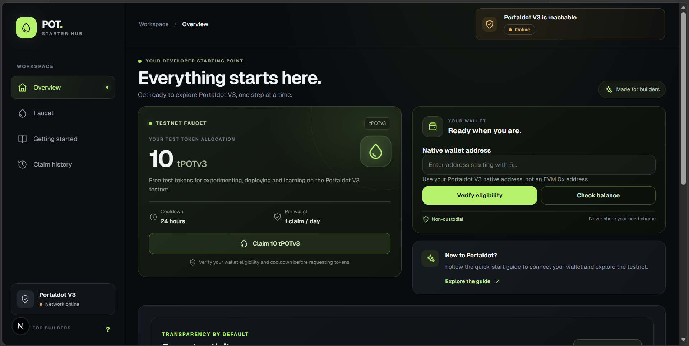
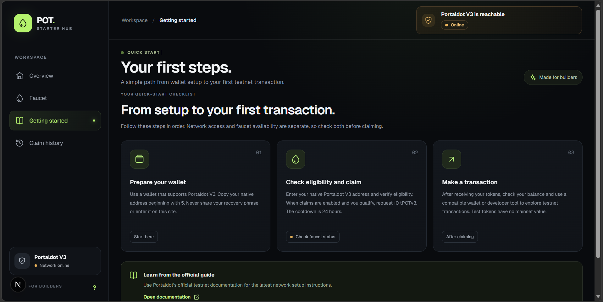
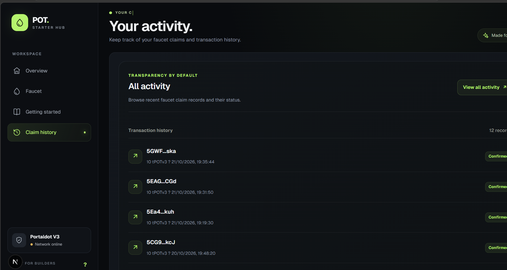
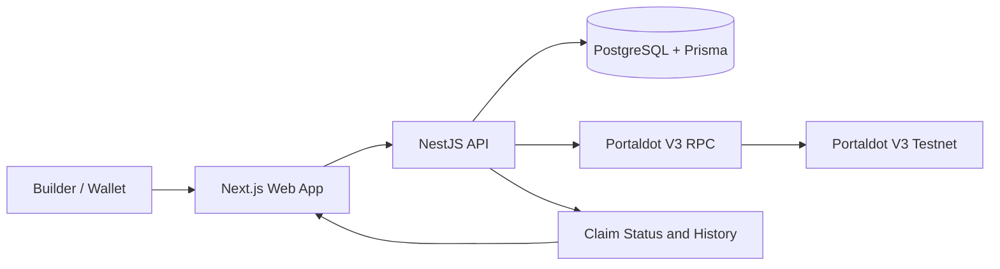

<div align="center">

# POT Starter Hub

### Your starting point for building on Portaldot V3

A self-service testnet faucet and developer quick-start hub for receiving **10 tPOTv3**, checking wallet eligibility, and exploring Portaldot V3.

[Live Demo](https://pot-starter-hub.vercel.app) ·
[GitHub Repository](https://github.com/neduojile/pot-starter-hub) ·
[Portaldot Node Console](https://node-console.portaldot.dev)

</div>

---

## Overview

POT Starter Hub helps builders get started on the Portaldot V3 testnet through a simple interface for wallet eligibility checks, test-token claims, balance checks, and claim-history visibility.

| Network detail | Value |
|---|---|
| Network | Portaldot V3 Testnet |
| Test token | tPOTv3 |
| Faucet allocation | 10 tPOTv3 per confirmed claim |
| Cooldown | 24 hours per wallet |
| Native wallet format | Address beginning with `5` |
| EVM Chain ID | `420420777` |

## Screenshots

These screenshots showcase the main areas of the application.

### Overview



### Getting Started



### Claim History



> Ensure the three screenshot files exist at the paths above before submitting the repository.

## Core Features

- **Testnet faucet:** Request 10 tPOTv3 when claims are enabled and the wallet is eligible.
- **Native wallet eligibility:** Check a Portaldot native address before requesting tokens.
- **Balance check:** Inspect the wallet's available testnet balance.
- **Claim status and history:** Review recent claim records and their reported status.
- **Cooldown enforcement:** Apply a 24-hour cooldown after a claim is confirmed.
- **Developer quick start:** Follow a guided path from wallet preparation to the first testnet transaction.
- **Responsive interface:** Access the hub on desktop or mobile.

## Portaldot V3 Network Details

| Setting | Value |
|---|---|
| Network | Portaldot V3 Testnet |
| Substrate WebSocket RPC | `wss://test-node-v3.portaldot.dev` |
| EVM RPC | `https://test-evm-rpc-v3.portaldot.dev` |
| EVM Chain ID | `420420777` |
| Token | `tPOTv3` |
| Token decimals | `14` |
| Node Console | [node-console.portaldot.dev](https://node-console.portaldot.dev) |

**Important:** Use a native Portaldot address beginning with `5` for the faucet. An EVM `0x` address is not a substitute for the native address field.

## How to Use

1. Open the [live application](https://pot-starter-hub.vercel.app).
2. Prepare a wallet that supports Portaldot V3 and copy its native address.
3. Enter the address and select **Verify eligibility**.
4. Review the eligibility and cooldown result.
5. If eligible and claims are enabled, request **10 tPOTv3**.
6. Check the claim status and transaction details when available.
7. Open **Claim history** to review recent activity.

Network reachability and faucet claim availability are separate conditions. A submitted request is not necessarily a finalized transaction.

## Technology Stack

| Component | Technology |
|---|---|
| Web application | Next.js, React, TypeScript |
| API | NestJS, TypeScript |
| Database | PostgreSQL, Prisma ORM |
| Monorepo and builds | pnpm workspaces, Turborepo |
| Blockchain integration | Polkadot API tooling |
| Web deployment | Vercel |
| API deployment | Render |

## Repository Structure

```text
pot-starter-hub/
├── apps/
│   ├── web/                  # Next.js frontend and API proxy routes
│   └── api/                  # NestJS faucet API and transfer adapter
├── packages/
│   ├── blockchain/           # Blockchain integration utilities
│   └── database/             # Prisma schema, migrations and client
├── package.json
├── pnpm-workspace.yaml
├── turbo.json
└── README.md
```

## Local Development

### Requirements

- Node.js 24 or a compatible version required by the repository
- Corepack-enabled pnpm
- PostgreSQL database

### Install dependencies

```powershell
corepack pnpm install
```

### Configure environment variables

Configure the database connection and the environment variables required by the API using the project's environment files.

Never commit `.env` files, database credentials, seed phrases, or private keys.

### Build the database package and API

```powershell
corepack pnpm --filter @pot-starter-hub/database build
corepack pnpm --filter @pot-starter-hub/api build
```

### Build the web application

```powershell
corepack pnpm --filter web build
```

Use the development scripts defined in the root and workspace package manifests to run the application locally. Start PostgreSQL and configure the required environment variables before starting the API and web application.

## API Endpoints

| Method | Endpoint | Purpose |
|---|---|---|
| `GET` | `/health` | Health check |
| `GET` | `/faucet/config` | Read faucet configuration |
| `GET` | `/faucet/history` | Read recent claim history |
| `GET` | `/faucet/eligibility/:walletAddress` | Check wallet eligibility |
| `POST` | `/faucet/claim` | Submit a faucet claim request |

**Deployed API health check:** [pot-starter-hub.onrender.com/health](https://pot-starter-hub.onrender.com/health)

## Architecture



The web application provides the user interface and communicates with the API. The API validates claim requests, checks eligibility and cooldown records, coordinates blockchain transfer execution, and stores claim status for history views.

## Current Scope and Limitations

- The project targets the **Portaldot V3 testnet** and test tokens only.
- A successful request does not automatically mean a blockchain transfer has finalized.
- Availability depends on testnet RPC access, deployment health, database connectivity, and faucet configuration.
- Transaction details should be treated as confirmed only when the application reports confirmation.
- Test tokens have no mainnet value.

## Security Notes

- Never enter or share a seed phrase or private key with the faucet.
- Keep environment variables and database credentials private.
- Use native Portaldot addresses for the native-wallet workflow.
- Never send mainnet assets to testnet addresses.

## Project Status

POT Starter Hub is an actively developed testnet onboarding prototype. The live demo showcases its faucet workflow, wallet eligibility checks, developer guidance, and claim-history interface. Features that depend on live network confirmation remain subject to testnet availability.

## Contributing

1. Fork the repository.
2. Create a focused feature branch.
3. Make and test your changes.
4. Run the relevant package builds.
5. Open a pull request describing the change and verification steps.

## License

No license has been specified in this repository yet. Unless a license is added, the code should not be assumed to be available for unrestricted reuse.

---

<div align="center">

Built for developers exploring **Portaldot V3**.

</div>
